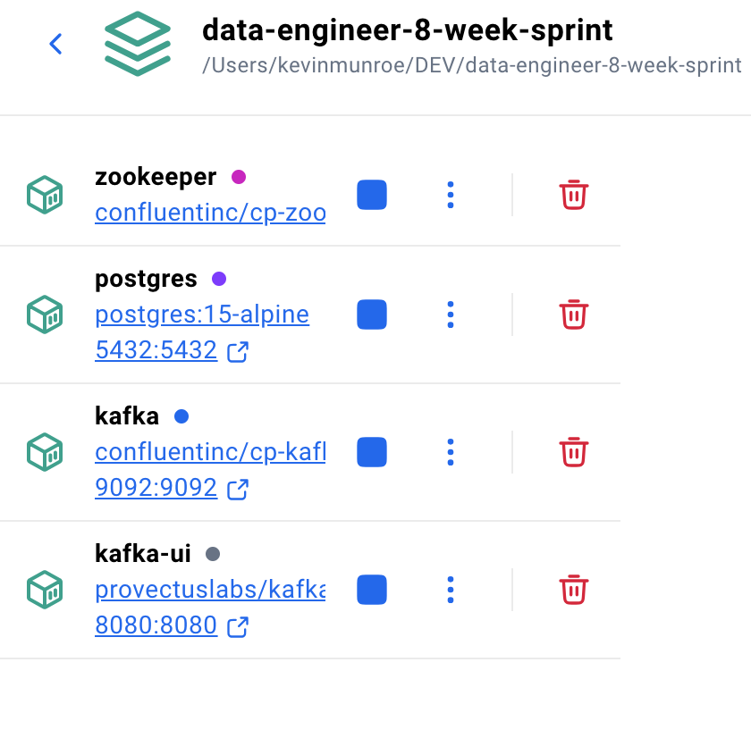

Today marked the official kickoff for my data engineering sprint. Before diving into real-time streaming with Kafka, I needed to get a reliable, containerized local database up and running. Here is a breakdown of how I configured my local environment using Docker Compose and TablePlus.

Lets's start with a git repo:
```
data-engineering-8-week-sprint/
├── _config.yml
├── docker-compose.yml
├── _posts/
│   ├── 2026-10-22-setup-infrastructure.md
│   └── images/
│       ├── docker-postgres-terminal.png
│       └── tableplus-connection-success.png
├── templates/
│   └── post-template.md
└── index.md
```

## Preface: The Old MacOS Issue


I have an older Intel-based Macbook Pro running MacOS Monterey 12.7.6. Newer Docker Desktop releases expect Apple Silicon, but you are not SOL- older versions can be found 
here: [WildSiphon/DockerDesktop.yaml](https://gist.github.com/WildSiphon/d1aadf81c28ba05269ba639cbfcca2e0). The best Docker Desktop supporting Monterey
is here: https://desktop.docker.com/mac/main/amd64/191736/Docker.dmg 

This is new to me- Docker works on a subscription basis, so you must login with a work
email or personal email, to get here (I chose personal):


Check everything is running with `docker compose ps`:

```
de_kafka       confluentinc/cp-kafka:7.5.0       "/etc/confluent/dock…"   kafka       26 seconds ago   Up 24 seconds   0.0.0.0:9092->9092/tcp
de_kafka_ui    provectuslabs/kafka-ui:latest     "/bin/sh -c 'java --…"   kafka-ui    26 seconds ago   Up 24 seconds   0.0.0.0:8080->8080/tcp
de_postgres    postgres:15-alpine                "docker-entrypoint.s…"   postgres    29 seconds ago   Up 25 seconds   0.0.0.0:5432->5432/tcp
de_zookeeper   confluentinc/cp-zookeeper:7.5.0   "/etc/confluent/dock…"   zookeeper   29 seconds ago   Up 25 seconds   2181/tcp, 2888/tcp, 3888/tcp
```
Ditto in Docker Desktop UI:



## The Architecture Setup

To keep my local environment identical to what a containerized production pipeline expects, I opted to run PostgreSQL inside a Docker container (`de_postgres`) rather than relying on a native host installation. 

However, running both native macOS services (like Postgres.app) and Docker instances can lead to port conflicts on standard ports like `5432`. 

### Key Steps & Solutions

1. **Isolating Port `5432`:**
   Ensured that the local host port mapping correctly targeted the Docker container defined in `docker-compose.yml`:
   ```yaml
   services:
     postgres:
       image: postgres:15-alpine
       container_name: de_postgres
       environment:
         POSTGRES_USER: postgres
         POSTGRES_PASSWORD: postgrespassword
         POSTGRES_DB: engineering_db
       ports:
         - "5432:5432"
   
2. **Connecting psql:**
Now lets connect to postgresql db with `psql`:

```bash
Monterey-2015-Kevins-Macbook-Pro:images kevinmunroe$ psql -h localhost -U postgres -d engineering_db
-bash: psql: command not found
```


Whoops, no psql. So install psql: `brew install libpq`. Easier said than done:
```bash
Monterey-2015-Kevins-Macbook-Pro:images kevinmunroe$ brew install libpq
Error: Your Xcode (12.4) at /Applications/Xcode.app is too outdated.

Please update to Xcode 14.2 (or delete it).
```
Curse of the old MacBook. Updating Xcode is orthogonal to the mission and I'd rather skip it right now. 
Since Postgres is already running on port 5432, I can skip psql altogether 
for now and use any old generic interface.
I chose TablePlus (Free Edition is powerful enough). 

3. **Resolving Authentication Mismatches:**
   Early on, connecting via a GUI threw a FATAL: password authentication failed for user "postgres" error. Gemini says: 
> This happens because PostgreSQL only evaluates the POSTGRES_PASSWORD environment variable during initial volume creation.

   To clear out old cached credentials from a previous container state, I had to completely wipe the persistent volume and re-initialize:

```commandline
docker compose down -v
docker compose up -d
```

4. **Connecting via TablePlus:**
Once the container spun up with a clean volume, connecting TablePlus was straightforward:

```yaml
Host: localhost
Port: 5432
User: postgres
Database: engineering_db
```


### What's Next?
With a live database connection confirmed in TablePlus, the infrastructure foundation is ready to go. In the next post, I'll be wiring up a local Kafka cluster and writing a Python producer to stream test events directly into this pipeline.
